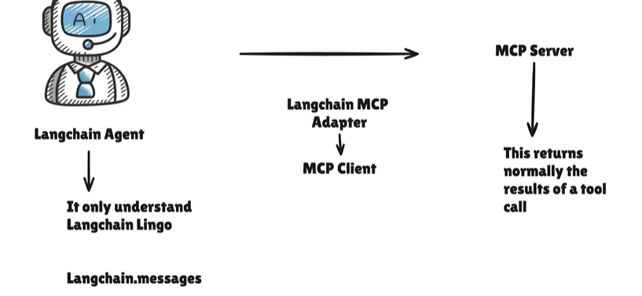
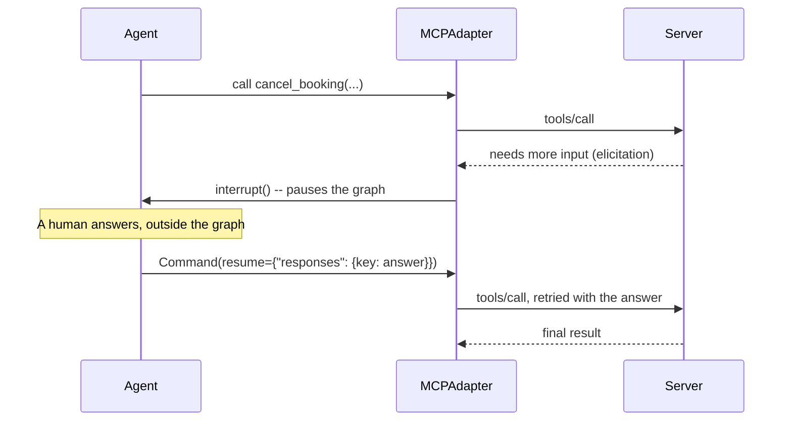
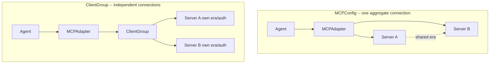
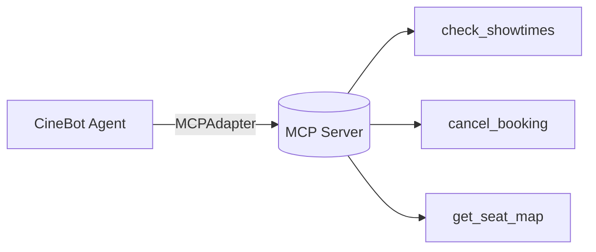

# Model Context Protocol (MCP)
* Model Context Protocol (MCP) standardizes how applications provide tools and context to language models.
* LangChain agents call tools defined on MCP servers through **MCPAdapter**, which discovers a server’s tools and adapts them into LangChain tools that can pass straight to create_agent.

### Installation
```sh
    uv add "langchain[mcp]" fastmcp
```
## MCPAdapter
* `MCPAdapter` is built on `FastMCP`, which handles transport inference, protocol negotiation, connection management, and authentication. 
* It then converts discovereds MCP tools with `list_tools()` into asynchronous LangChain tools.
* The resulting tools can be passed directly to create_agent.
* Langchain MCP Adapter is Universal Tranlator i.e. One Adaptor and it figures out on its own whether its talking to Local MCP over HTTP.




    ```python
    from langchain.agents import create_agent
    from langchain.mcp import MCPAdapter
    async def main():
    async with MCPAdapter("https://docs.langchain.com/mcp") as adapter:
        tools = await adapter.list_tools()
        agent = create_agent("gpt-5-mini", tools)
        return await agent.ainvoke({
                "messages": [{"role": "user", "content": "How do I add short-term memory to a LangChain agent?"}]}
                )
    ```

## Transports
* `MCPAdapter` infers the `transport` from the target provided to it.
* A target can be any of the following:
    * **http/https URL (str)**: reached over streamable HTTP.
    * **script path (Path)**: launched as a subprocess over stdio.
    * **A transport object (StreamableTransport)**: a pre-configured transport object.
    * **An in-process FastMCP server**: connected in-memory, with no subprocess or socket.
    * **An MCPConfig dict ({"mcpServers": {...}})**: several servers behind one adapter.
    * **A prebuilt fastmcp.Client**: for full control over transport, caching, and protocol negotiation.

    ```python
    from pathlib import Path
    from langchain.mcp import MCPAdapter
    # An in-process FastMCP server: no subprocess, no socket. Ideal for tests.
    in_memory = MCPAdapter(server)  # a FastMCP instance
    # A script path is launched over stdio, one subprocess per adapter.
    stdio = MCPAdapter(Path("weather_server.py"))
    # A string must be an http(s) URL, reached over streamable HTTP.
    http = MCPAdapter("https://example.com/mcp")
    ```

## Tools

### 1. Tool Output: Multimodal Content Blocks
An MCP tool result isn't limited to text. 
* `langchain.mcp` converts whatever the server sends text, images, embedded files into standard LangChain **content blocks**, 
* Model sees a uniform shape regardless of what kind of server produced it.

| MCP content type | Converts to |
|---|---|
| `TextContent` | text content block |
| `ImageContent` | image content block (base64 + mime type) |
| `ResourceLink` (image mime type) | image content block (by URL) |
| `ResourceLink` (other) | file content block |
| `EmbeddedResource` (text) | text content block |
| `EmbeddedResource` (blob) | image or file content block, by mime type |
| `AudioContent` | **not yet supported** — raises `NotImplementedError` |

### 2. Structured content
* When a tool returns structured content, the adapter attaches it to the ToolMessage as an artifact instead of text.
* e.g. `mcp_tool` in MCP server is returning a Json / Dict object which is a structured output.
    ```json
        {"movie": "movie_title", "available_rows": ["A", "B", "C"], "sold_out_rows": ["D"]}
    ```
* Langcahin provides 2 ways to read the Tool results returned from MCP
    * `.artifact` to access the structured data returned by the tool
    * `.content` provides the textual content that the model reads

### 3 Error handling
* An MCP tool result carries an `isError` flag. 
* When a server reports `isError=True`, the adapter converts it into a ToolMessage with `status="error"` carrying the server’s own message, so the agent can read it and correct itself:

| Failure | What happened | What the agent sees |
|---|---|---|
| Server tool **ran and reported failure** (`isError=True`) | The tool executed, then explicitly failed (bad input, business-rule violation) | A `ToolMessage` with `status="error"` — **the agent can read it and self-correct**, same as any other tool error in this course |
| **Transport / session failure** | The connection dropped, the server crashed, the process couldn't start | **Raises an exception** — there is no error `ToolMessage` for the model to reason about, because nothing came back to convert |

### 4. Tool metadata
* MCP tool may carry its MCP meta information under an `mcp` namespace / key on the LangChain tool’s `metadata`
  ```json
  {
    "mcp": {
      "tool": {
          "annotations": {
          "destructive_hint": True,
          "read_only_hint": False,
        },
        "_meta": {"origin": "crm"},
      },
      "server": {
          "name": "crm",
          "version": "2.1.0",
      },
    },
  }
  ```
* Every nested field is optional: a server may provide tool annotations, _meta, server identity, any combination of those, or none. 
* `annotations` contains MCP hints such as `read_only_hint`, `required_authentication`, `idempotent_hint`, `open_world_hint` and `destructive_hint`, `_meta` is metadata supplied by the server and server identifies the MCP implementation that advertised the tool.
* Read optional metadata defensively, so a missing field returns a default rather than failing

### 5. Human-in-the-loop
* The MCP `annotation` classifies the tool and LangChain’s `human-in-the-loop middleware` enforces the approval policy.
* Read the `destructive_hint` from metadata once during tool discovery. 
* Then give the `human-in-the-loop` configuration a `when` predicate that receives each tool call and returns whether the call needs approval.
* When agent calls a tool that has interrupt, the run pauses. 
* Approve the call to run it, or reject it to skip the tool and tell the model
  ```python
    resumed = await agent.ainvoke(Command(resume={"decisions": [{"type": "approve"}]}), config)
  ```

### 6. Elicitation: When the Server Needs to Ask a Question Mid-Call
* Some MCP tools need clarification partway through a call — "confirm you want to proceed?".
* `langchain.mcp` answers this **automatically with a LangGraph `interrupt()`**  
* Every client `MCPAdapter` builds is armed for it by default, no extra code needed to enable it.



## Connections
* MCPAdapter opens an MCP connection, discovers tools, and returns LangChain tools your agent can call
* The connection itself is FastMCP’s

#### Connection lifecycle
* `MCPAdapter` is an async context manager. Entering it connects the underlying client; exiting it releases the connection. 

### Multiple servers
* To give one agent tools from several servers, choose 
    * `MCPConfig` when a single aggregate connection is enough
    * `ClientGroup` when each server needs its own connection (per-server authentication, or a shared pool configured per client).


Real deployments rarely talk to just one MCP server. Two patterns, with a real tradeoff:

| Pattern | What it does | Tool naming | Protocol negotiation |
|---|---|---|---|
| **`MCPConfig` dict** | One aggregate connection across several servers | Prefixed by the config key you choose | **Shared** — the whole fleet negotiates down to the oldest protocol era any member requires |
| **`ClientGroup`** | Independent connections, one per server | Namespaced `{server}_{tool}` automatically | **Independent** — each member keeps its own protocol era and auth |

**1. One aggregate connection with MCPConfig**
* Give the adapter an MCPConfig dict to connect to several servers behind one aggregate endpoint
    ```python
    from langchain.agents import create_agent
    from fastmcp.mcp_config import MCPConfig
    from langchain.mcp import MCPAdapter
    config: MCPConfig = {
        "mcpServers": {
            "weather": {"command": "python", "args": ["/path/to/weather_server.py"]},
            "calc": {"command": "python", "args": ["/path/to/calc_server.py"]},
        }
    }

    async def fleet_agent(config):
        async with MCPAdapter(config) as adapter:
            # Every tool is prefixed with its config key (`weather_...`, `calc_...`),
            # so two servers exposing the same tool name stay distinguishable.
            tools = await adapter.list_tools()
            return create_agent("claude-sonnet-5", tools)
    ```

**2. Independent connections with ClientGroup**
* To keep each server on its own connection, pass a `ClientGroup`. 
* Each connection keeps its own negotiated protocol era, authentication, and the group routes each call back to the client that advertised the tool. 

    ```python
    from fastmcp.client import Client
    from fastmcp.client.group import ClientGroup
    from langchain.agents import create_agent
    from langchain.mcp import MCPAdapter
    async def agent_from_group(legacy_url: str, modern_url: str):
        # One connection per server: a `ClientGroup` keeps each server on its own
        # negotiated protocol era, so a legacy and a modern server run side by side.
        # It also namespaces every tool as `{server}_{tool}`, so two servers exposing
        # the same tool name stay distinct.
        group = ClientGroup({"weather": Client(legacy_url, mode="legacy"),"calc": Client(modern_url, mode="auto")})
        async with MCPAdapter(group) as adapter:
            tools = await adapter.list_tools()
            return create_agent("claude-sonnet-5", tools)
    ```

## Authentication

--- 

# Notebook Example
