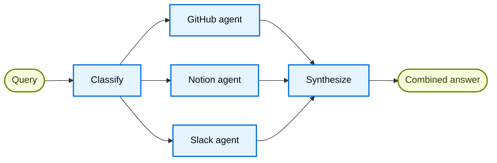
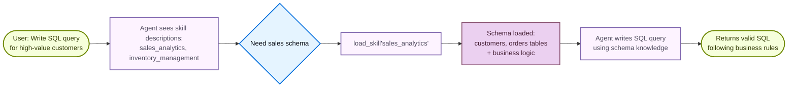

# Multi-Agent Patterns in LangChain
* Multi-agent systems coordinate specialized components to tackle complex workflows. 

## Why multi-agent?
* Multi-agents are used for one or more of these capabilities:
    * **Context management**: 
        * Provide specialized knowledge without overwhelming the model’s context window. 
        * If context were infinite and latency zero, you could dump all knowledge into a single prompt
        * **Context Isolation** helps to provide task specific context to sub agents to selectively surface relevant information.
    * **Distributed development:** Allow different teams to develop and maintain capabilities independently, composing them into a larger system with clear boundaries.
    * **Parallelization**: Spawn specialized workers for subtasks and execute them concurrently for faster results.

## Patterns
Here are the main patterns for building multi-agent systems, each suited to different use cases:

| Pattern | How it works |
| --- | --- |
| Subagents | A main agent coordinates subagents as tools. All routing passes through the main agent, which decides when and how to invoke each subagent. |
| Handoffs | Behavior changes dynamically based on state. Tool calls update a state variable that triggers routing or configuration changes, switching agents or adjusting the current agent’s tools and prompt. |
| Skills | Specialized prompts and knowledge loaded on-demand. A single agent stays in control while loading context from skills as needed. |
| Router | A routing step classifies input and directs it to one or more specialized agents. Results are synthesized into a combined response. |
| Custom workflow | Build bespoke execution flows with LangGraph, mixing deterministic logic and agentic behavior. Embed other patterns as nodes in your workflow. |

## Choosing a pattern

* **Distributed development**: Can different teams maintain components independently?
* **Parallelization**: Can multiple agents execute concurrently?
* **Multi-hop**: Does the pattern support calling multiple subagents in series?
* **Direct user interaction**: Can subagents converse directly with the user?

### A quick distinction: Subagents vs. Handoffs vs. Router

These three are the ones most often confused with each other, so it's worth being precise
about what separates them:

- **Subagents**: the *supervisor* is itself a full agent. It decides, turn by turn, which
  sub-agent-as-tool to call, and can call several in sequence or in parallel. The sub-agents
  don't talk to the user directly.
- **Handoffs**: there's no supervisor doing live reasoning about where to route. Instead, state
  (such as `current_step`, or which agent is "active") determines which prompt and tools are in
  effect right now. Agents can hand off to each other, or a single agent can reconfigure itself.
- **Router**: a *classification step* (often one structured-output LLM call, not a full agent)
  decides, once, which specialized agents are relevant, dispatches to all of them **in
  parallel**, and a synthesis step combines their answers. There's no multi-turn orchestration.

### 1. Subagents
* A **supervisor** agent coordinates both, deciding which tool to call for a given request and combining their results into one coherent answer. 
* We'll also add **human-in-the-loop review**
so a person can approve, edit, or reject sensitive actions (like an outbound email) before
they actually happen.

#### Why a supervisor, instead of one agent with every tool?
* Give one agent direct access to both calendar and email APIs, and it has to choose from similar-looking tools, understand each API's exact format, and juggle two unrelated domains in one prompt. 
* Splitting the work into two focused specialists, each with its own tools and prompt, keeps each one simple and makes each one independently testable.

### 2. Handoffs
* In the handoffs architecture, behavior changes dynamically based on state.
* Unlike Subagents, where a supervisor calls separate agents as tools, the **state machine pattern** uses a **single agent** whose configuration (system prompt + tools) changes dynamically based on where the conversation is. 

### 3. Router
* In the router architecture, a routing step classifies input and directs it to specialized agents.
* This is useful when you have distinct verticals (separate knowledge domains that each require their own agent).

### 4. Skills
* In the skills architecture, specialized capabilities are packaged as invocable “skills” that augment an agent’s behavior.
* Skills are primarily prompt-driven specializations that an agent can invoke on-demand
* This uses **progressive disclosure** loading information on demand instead of upfront 
* To Implement **skills**: specialized, prompt-based instructions the agent loads via tool calls or middlewares.

## Performance comparison

## Useful Resources for Learning MultiAgents
* [**MultiAgent System**](https://ai-automation-with-mayank.netlify.app/#agents)