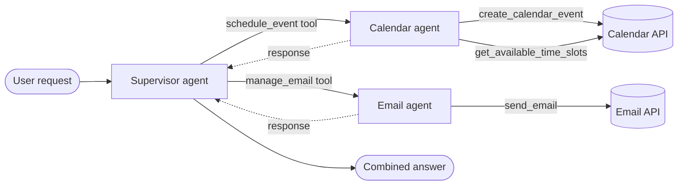
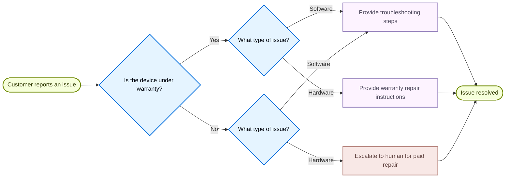
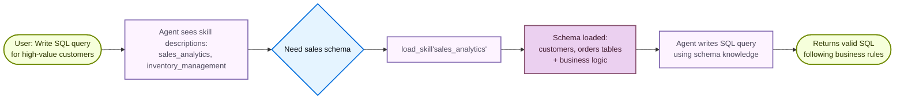

# Multi-Agent Patterns in LangChain
* Multi-agent systems coordinate specialized components to tackle complex workflows. 

## Why multi-agent?
* Multi-agents are used for one or more of these capabilities:
    * **Context management**: 
        * Provide specialized knowledge without overwhelming the model’s context window. 
        * If context were infinite and latency zero, you could dump all knowledge into a single prompt
        * **Context Isolation** helps to provide task specific context to sub agents to selectively surface relevant information.
    * **Distributed development:** Allow different teams to develop and maintain capabilities independently, composing them into a larger system with clear boundaries.
    * **Parallelization**: Spawn specialized workers for subtasks and execute them concurrently for faster results.

## Patterns
Here are the main patterns for building multi-agent systems, each suited to different use cases:

| Pattern | How it works |
| --- | --- |
| Subagents | A main agent coordinates subagents as tools. All routing passes through the main agent, which decides when and how to invoke each subagent. |
| Handoffs | Behavior changes dynamically based on state. Tool calls update a state variable that triggers routing or configuration changes, switching agents or adjusting the current agent’s tools and prompt. |
| Skills | Specialized prompts and knowledge loaded on-demand. A single agent stays in control while loading context from skills as needed. |
| Router | A routing step classifies input and directs it to one or more specialized agents. Results are synthesized into a combined response. |
| Custom workflow | Build execution flows with LangGraph, mixing deterministic logic and agentic behavior. Embed other patterns as nodes in workflow. |

## Choosing a pattern
* **Distributed development**: Can different teams maintain components independently?
* **Parallelization**: Can multiple agents execute concurrently?
* **Multi-hop**: Does the pattern support calling multiple subagents in series?
* **Direct user interaction**: Can subagents converse directly with the user?

### A quick distinction: Subagents vs. Handoffs vs. Router
These three are the ones most often confused with each other, so it's worth being precise about what separates them:
- **Subagents**: 
    * The *supervisor* is itself a full agent. 
    * It decides, turn by turn, which subagent-as-tool to call. 
    * The sub-agents don't talk to the user directly.
- **Handoffs**: 
    * There's no supervisor doing reasoning about where to route. 
    * Instead, state (such as `current_step`, or which agent is "active") determines which prompt and tools are in
  effect right now. 
    * Agents can hand off to each other, or a single agent can reconfigure itself.
- **Router**: 
    * A *classification step* (often one structured-output LLM call) decides, which specialized agents are relevant, dispatches to all of them **in parallel**
    * A synthesis step combines their answers. There's no multi-turn orchestration.

### 1. Subagents
* A **supervisor** agent coordinates both, deciding which tool to call for a given request and combining their results into one coherent answer. 


#### Why a supervisor, instead of one agent with every tool?
* Splitting the work into two focused specialists, each with its own tools and prompt, keeps each one simple and makes each one independently testable.

#### Implementation approach
The core mechanism wraps a subagent as a tool that the main agent can call
```python
# Create a subagent
subagent = create_agent(model="google_genai:gemini-3.6-flash", tools=[...])

# Wrap it as a tool
@tool("research", description="Research a topic and return findings")
def call_research_agent(query: str):
    result = subagent.invoke({"messages": [{"role": "user", "content": query}]})
    return result["messages"][-1].content
# Main agent with subagent as a tool
main_agent = create_agent(model="google_genai:gemini-3.6-flash", tools=[call_research_agent])
```

### 2. Handoffs
* In the handoffs architecture, behavior changes dynamically based on state.
* Each agent can hand off to others or respond directly to the user.


#### Implementation approachs
**1. single agent with middleware (one agent with dynamic configuration)**
* A single agent changes its behavior based on state. Middleware intercepts each model call and dynamically adjusts the system prompt and available tools
```python
from langchain.tools import ToolRuntime, tool
from langchain.messages import ToolMessage
from langgraph.types import Command

@tool
def record_warranty_status(status: str,runtime: ToolRuntime[None, SupportState]
) -> Command:
    """Record warranty status and transition to next step."""
    return Command(
        update={"messages": [ToolMessage(content=f"Warranty status recorded: {status}", tool_call_id=runtime.tool_call_id)],
                "warranty_status": status,
                "current_step": "specialist"}  # Update state to trigger transition
        )
```
**2. Multiple agent subgraphs (distinct agents as graph nodes)**
* Multiple distinct agents exist as separate nodes in a graph. 
* Handoff tools navigate between agent nodes using `Command.PARENT` to specify which node to execute next.
>Note: Subgraph handoffs require careful context engineering. 
>Unlike single-agent middleware (where message history flows naturally), you must explicitly decide what messages pass between agents. 
>Get this wrong and agents receive malformed conversation history or bloated context.

*Handling context during handoffs*
* When handing off between agents, we need to ensure the conversation history remains valid. 
* LLMs expect tool calls to be paired with AI responses,
* So when using `Command.PARENT` to hand off to another agent, you must include both:
    * The `AIMessage` containing the tool call (the message that triggered the handoff)
    * A `ToolMessage` acknowledging the handoff (the artificial response to that tool call)
```python
@tool
def transfer_to_sales(runtime: ToolRuntime,) -> Command:
    """Transfer to the sales agent."""
    last_ai_message = next(msg for msg in reversed(runtime.state["messages"]) if isinstance(msg, AIMessage))
    transfer_message = ToolMessage(content="Transferred to sales agent", tool_call_id=runtime.tool_call_id,)
    return Command(goto="sales_agent",
        update={"active_agent": "sales_agent","messages": [last_ai_message, transfer_message]},
        graph=Command.PARENT)
```

### 3. Router
* In the router architecture, a routing step classifies input and directs it to specialized agents.
* Results are synthesized.
* This is useful when you have distinct verticals (separate knowledge domains that each require their own agent).

#### Implementation Approches
**1. Route to Single Agent**
* Use `Command` to route to a single specialized agent:
```python
    from langgraph.types import Command

    def classify_query(query: str) -> str:
        """Use LLM to classify query and determine the appropriate agent."""
        # Classification logic here

    def route_query(state: State) -> Command:
        """Route to the appropriate agent based on query classification."""
        active_agent = classify_query(state["query"])
        # Route to the selected agent
        return Command(goto=active_agent)
```
**2. Route to multiple specialized Agents**
* Use `Send` to fan out to multiple specialized agents in parallel:
```python
    from langgraph.types import Send

    class ClassificationResult(TypedDict):
        query: str
        agent: str

    def classify_query(query: str) -> list[ClassificationResult]:
        """Use LLM to classify query and determine which agents to invoke."""
        # Classification logic here

    def route_query(state: State):
        """Route to relevant agents based on query classification."""
        classifications = classify_query(state["query"])
        # Fan out to selected agents in parallel
        return [Send(c["agent"], {"query": c["query"]}) for c in classifications]
```
#### Stateless vs. stateful
* **Stateless routers** 
    * Each request is routed independently—no memory between calls
* **Stateful routers** 
    * For multi-turn conversations, we need to maintain context across invocations.
    * **Tool wrapper**: wrap the stateless router as a tool that a conversational agent can call. 
    * The conversational agent handles memory and context and the router stays stateless. 
        ```python
            @tool
            def search_docs(query: str) -> str:
                """Search across multiple documentation sources."""
                result = workflow.invoke({"query": query})
                return result["final_answer"]

            # Conversational agent uses the router as a tool
            conversational_agent = create_agent(model, tools=[search_docs],
                prompt="You are a helpful assistant. Use search_docs to answer questions.")
        ```
### 4. Skills
* A single agent loads specialized prompts and knowledge on-demand while staying in control.
* This uses **progressive disclosure** loading information on demand instead of upfront. 
* To Implement **skills**: specialized, prompt-based instructions the agent loads via tool calls or middlewares.



## Performance comparison
**Key metrics:**
1. *Model calls*: Number of LLM invocations. More calls = higher latency (especially if sequential) and higher per-request API costs.
2. *Tokens processed*: Total context window usage across all calls. More tokens = higher processing costs and potential context limits.

### 3 Scenarios
1. **One-shot request:** > User: “Buy coffee”
2. **Repeat request:** > Turn 1: “Buy coffee” Turn 2: “Buy coffee again”
3. **Multi-domain:** > User: “Compare Python, JavaScript, and Rust for web development”

Here’s how patterns compare across all three scenarios:

| Pattern | One-shot | Repeat request | Multi-domain |
|---|---|---|---|
| Subagents | 4 calls | 8 calls (4+4) | 5 calls, 9K tokens |
| Handoffs | 3 calls | 5 calls (3+2) | 7+ calls, 14K+ tokens |
| Skills | 3 calls | 5 calls (3+2) | 3 calls, 15K tokens |
| Router | 3 calls | 6 calls (3+3) | 5 calls, 9K tokens |

## Choosing a pattern
| Optimize for | Subagents | Handoffs | Skills | Router |
|---|---|---|---|---|
| Single requests |  | ✅ | ✅ | ✅ |
| Repeat requests |  | ✅ | ✅ |  |
| Parallel execution | ✅ |  |  | ✅ |
| Large-context domains | ✅ |  |  | ✅ |
| Simple, focused tasks |  |  | ✅ |  |

## Quick comparison

| Pattern | Best use case | Cost & call efficiency |
| --- | --- | --- |
| Skills | Reusable instructions, workflows, domain expertise | Usually best when one model can execute the task with loaded instructions |
| Router | Choosing one specialist based on the request | Efficient if routing is cheap and only one specialist is invoked |
| Handoffs | Sequential workflows where the next step depends on the previous result | More calls and context passing; use only when necessary |
| Subagents | Independent tasks that can run in parallel | Higher total cost, but potentially lower wall-clock latency |

## When to use each pattern
- Skills — default for cost optimization. Use for repeatable tasks such as coding conventions, document generation, or standard workflows. Reuse instructions and avoid additional model calls when possible. Skills themselves do not inherently require extra calls; it depends on how they are loaded and executed.

- Router — best for selecting one path. Use when requests fall into distinct categories, such as shopping, coding, or research. Route to one suitable handler rather than invoking every specialist. A separate LLM router can add unnecessary overhead; use rules or a lightweight classifier when sufficient.

- Handoffs — best for dependent steps. Use when one agent must finish before another can act, such as planning → execution → verification. Minimize handoffs by combining compatible steps and passing only the necessary context.

- Subagents — Use the subagents pattern when you have multiple distinct domains (e.g., calendar, email, CRM, database), subagents don’t need to converse directly with users, or you want centralized workflow control.This can reduce elapsed time, but each subagent adds processing cost. Avoid it for simple requests or when only one result is needed.

Bottom line: Start with direct execution + reusable skills. Add a router when task selection becomes necessary, handoffs for genuinely dependent stages, and subagents when parallel work provides enough benefit to justify the additional cost.

### Takeaways
> - **Subagents**: stateless by design -- strong context isolation, but repeats the full flow on
>   every request (no "it's already loaded" discount). Best for parallel, large-context domains.
> - **Handoffs & Skills**: *stateful* -- once a step/skill is active, repeat requests skip
>   re-routing or re-loading, saving 40-50% of calls on the second ask. Best for single/repeat
>   requests needing direct user conversation.
> - **Router**: stateless per request (an LLM classification call every time), but supports true
>   parallel fan-out. Best when you have clear, parallel verticals and don't need the router
>   itself to remember anything.


## Useful Resources for Learning MultiAgents
* [**MultiAgent System**](https://ai-automation-with-mayank.netlify.app/#agents)